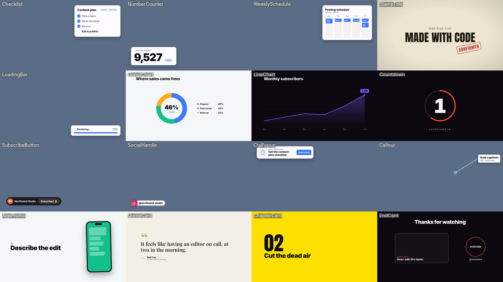

# Motion graphics

Motion graphics here are **code**: React components rendered frame by frame with [Remotion](https://www.remotion.dev). Code stays editable. Change a prop, re-render, and every frame updates. A starter project with working templates is in `templates/`.

## Workflow

**Not sure which look to use?** If the user hasn't chosen a style, or says "you choose", use the `style-advisor` skill first. If a `style-choice.json` exists in their project folder, follow it.


1. **Brief.** Pin down the job of the graphic: what it says, where it sits (full screen or overlay), how long it lasts, aspect ratio, and the brand (colors, fonts, logo). If there's a design style, read it from the `explainer-videos` skill's `references/design-styles.md` or the user's brand.
2. **Check the library first.** Read `templates/src/library/catalog.json` (16 templates with descriptions and default props) and the core templates below. If one fits, use it and only change props. Write a new component only when nothing fits.
3. **Build** in the Remotion workspace (if setup hasn't run, suggest `/video-studio:setup`, or copy `templates/` and run `npm install`):
   ```bash
   cd ~/video-studio              # workspace made by /video-studio:setup (path in ~/.video-studio/setup.json)
   npx remotion studio            # live preview in the browser
   ```
4. **Render:**
   ```bash
   npx remotion render src/index.ts Checklist out/checklist.mov --codec=prores --prores-profile=4444 --pixel-format=yuva444p10le --image-format=png   # transparent overlay
   npx remotion render src/index.ts KineticTitle out/title.mp4                                            # opaque
   npx remotion still src/index.ts BarChart out/check.png --frame=45                                      # one frame to check
   ```
5. **Verify.** Render stills at the start, the middle of each animation and the end. Look at them. Check text fits and doesn't overflow, nothing is cut off, it's readable on a phone, and the timing feels right. Fix, then re-render.
6. **Place it** over footage with ffmpeg: `ffmpeg -i video.mp4 -i overlay.mov -filter_complex "[0][1]overlay=0:0:enable='between(t,3,8)'" out.mp4` (or `-itsoffset 3` on the overlay input).

## Template library



`templates/src/library/` holds ready-made templates, listed in `catalog.json` with their default props. Overlays have a transparent background, a `position` (`top-left`, `top-right`, `bottom-left`, `bottom-right`, `center`) and a `size` multiplier. Most templates take `accent`, `text` and `surface` colors, so a design style can restyle them.

| Template | Category | Type | What it is |
| --- | --- | --- | --- |
| `Checklist` | Lists | overlay | Card with a to-do list that ticks off item by item with strike-through. Content plans, steps done, requirements. |
| `NumberCounter` | Data | overlay | Large metric that counts up with a live dot and a trend chip. Stats, followers, revenue, users. |
| `WeeklySchedule` | Lists | overlay | Week grid where posts pop into days. Posting cadence, content calendars, routines. |
| `StampTitle` | Titles | full frame | Case-file title card: typed kicker, slammed title, rubber stamp with a shake. Investigations, reveals, myths busted. |
| `LoadingBar` | UI | overlay | Progress bar stepping through stage labels with shimmer, then a done state. AI generating, uploading, processing. |
| `DonutChart` | Data | full frame | Donut chart sweeping in with legend and percentages. Market share, budget split, survey results. |
| `LineChart` | Data | full frame | Line that draws across with area fill and a pulsing end value. Growth over time, trends. |
| `Countdown` | UI | full frame | Ring countdown with punch-in numbers and a GO flash. Launches, intros, challenges. |
| `SubscribeButton` | Social | overlay | Channel chip with a cursor that clicks Subscribe; flips to Subscribed and rings the bell. |
| `SocialHandle` | Social | overlay | Platform icon pops and a pill unrolls with your handle. Watermarks, credits, follow prompts. |
| `CtaPopup` | Social | overlay | Notification-style CTA card with a pulsing button. Links in bio, free downloads, sign-ups. |
| `Callout` | Callouts | overlay | Pulsing ring on a point in the footage with a line drawn to a label. Point out UI, products, details. |
| `AppPromo` | Promo | full frame | Phone mockup cycling screens while numbered headlines slide; ends on app name and CTA. Add screenshots via public/. |
| `QuoteCard` | Titles | full frame | Serif pull quote revealing word by word, author with accent rule. Testimonials, quotes, key lines. |
| `ChapterCard` | Titles | full frame | Accent panel wipe with giant chapter number and title. Section breaks, listicle steps. |
| `EndCard` | Promo | full frame | End screen with watch-next slot, subscribe circle and handle. Last 5-20 s of YouTube videos. |

Example: a counter in the lower left, in your brand color, from 0.8 s to 5.8 s of a video:

```bash
npx remotion render src/index.ts NumberCounter out/counter.mov --codec=prores --prores-profile=4444 \
  --pixel-format=yuva444p10le --image-format=png \
  --props='{"value":12400,"from":0,"label":"newsletter readers","trend":"+12%","position":"bottom-left","accent":"#FF4D2E","text":"#0E1116","surface":"#FFFFFF","decimals":0,"countSeconds":1.6}'
ffmpeg -i talk.mp4 -itsoffset 0.8 -i out/counter.mov -filter_complex "[0][1]overlay=eof_action=pass" -c:a copy out.mp4
```

When placing several overlays at once, give each its own corner so nothing collides, ease them in around the line they illustrate, and keep each on screen at least 2 s.

To add a template: write `src/library/MyTemplate.tsx`, export it in `src/library/index.ts`, and add an entry to `catalog.json`. It then shows up in Remotion Studio under the Library folder.

## Core templates

| Composition | File | Use |
| --- | --- | --- |
| `KineticTitle` | `KineticTitle.tsx` | Word-by-word title with spring pop and focus blur. Hooks, section titles. |
| `EditorialReveal` | `EditorialReveal.tsx` | Serif headline with a mask-wipe reveal and underline draw. Premium or editorial tone. |
| `NeonPulse` | `NeonPulse.tsx` | Glowing text on a dark card with a subtle pulse. Tech, gaming, nightlife. |
| `LowerThird` | `LowerThird.tsx` | Name and role bar that slides in and out. Transparent. |
| `BarChart` | `BarChart.tsx` | Animated bars with counting numbers. |
| `LogoReveal` | `LogoReveal.tsx` | Logo scale-in with light sweep and tagline. |
| `PresetCaptions` | `PresetCaptions.tsx` | Word-highlight captions driven by any preset in `styles/caption-presets.json`. Transparent. |
| `Explainer` | `Explainer.tsx` | Renders a whole storyboard (title, bullets, steps, stat, chart, quote, image, CTA) in a design style. Used by the `explainer-videos` skill. |

`src/data/` holds copies of `styles/caption-presets.json` and `styles/design-styles.json` so the project works after you copy it elsewhere. If you edit the styles, copy them over again.

All components take props, so the same template serves many videos. Pass props on render: `--props='{"title":"Ship faster"}'`.

## Showcase videos

`templates/showcase/` builds three labelled example videos (an AI-video-editing explainer that uses every template, a 9:16 caption-styles short and a design-styles reel) with free local voiceover. Read `templates/showcase/README.md`, and use `src/showcase/` as a reference for combining templates, syncing animation to voice and layering overlays on footage.

## Animation principles

Details and easing values in `references/animation-principles.md`. The short version:

- **Everything is a function of `frame`.** Use `useCurrentFrame()`, `interpolate()` and `spring()`. Never use CSS transitions, `setTimeout` or `Math.random()` without a seed. Renders must be deterministic.
- **Timing:** entrances 8 to 15 frames (at 30 fps), exits slightly faster than entrances, holds long enough to read (about 0.3 s per word, at least 1.5 s).
- **Ease, don't lerp.** Use spring or ease-out for entrances and ease-in for exits. Linear motion only for constant drifts.
- **Stagger** related elements by 2 to 4 frames. It reads as one gesture.
- **One focal point** at a time. Animate the thing the viewer should read now; keep the rest still.
- **Safe areas:** keep text inside 90% of the frame (16:9). In 9:16 also avoid the bottom ~20% and right ~12% where platform UI sits.
- **Size for phones:** body text at least 4% of frame height; titles 7 to 12%.

## Animated captions

`PresetCaptions` reads a preset from `styles/caption-presets.json` (32 styles such as `tiktok`, `submagic`, `netflix`, `luxe`, `signal`). It uses `fontFamily`, `fontSize` (fraction of height), `color`, `highlightColor`, `highlightBackground`, `normalBackground`, `strokeWidth`, `textShadow`, `textTransform` and `wordsPerPage`, and plays the preset's `wordAnimation` keyframes when present. Feed it `words.json` from the `video-editing` skill. For a quick burn-in without React, use `video-editing/scripts/captions_to_ass.py`.

## Effects library

`styles/pixel-effects.json` lists 83 effects with their parameters (glow, CRT retro, RGB split, halftone, tilt-shift, letterbox, face-tracking zoom, laser eyes, magnifier and more). Use it as a menu of ideas. In Remotion, build them with CSS filters, SVG filters or a WebGL canvas (`@remotion/three` or a `<canvas>` shader). Validate any shader with a still render before rendering the full clip.

## Validation checklist

- [ ] `npx tsc --noEmit` passes.
- [ ] Still renders at key frames look right (no overflow, no clipped glyphs, correct fonts loaded).
- [ ] The first and last frames are clean (no half-drawn elements unless intended).
- [ ] Transparent renders really have alpha: `ffprobe` should report a `yuva...` pixel format. ProRes needs `--pixel-format=yuva444p10le --image-format=png`; WebM needs `--codec=vp9 --pixel-format=yuva420p --image-format=png`. Without these flags the alpha is silently dropped.
- [ ] Duration matches the brief, and text holds long enough to read.
